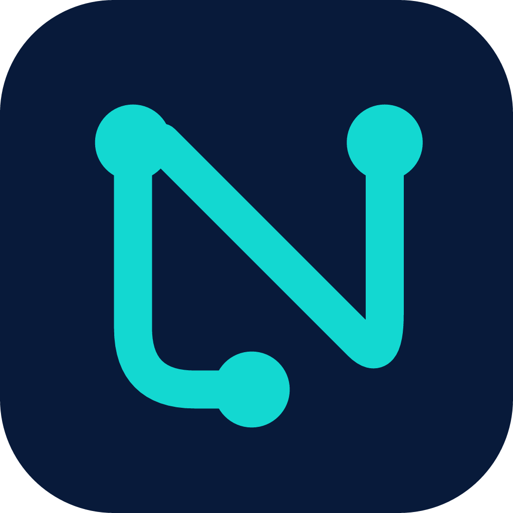

  

<h1 align="center">niraNG</h1>

  کلاینت اندروید Xray، sing-box و Aether با رابط Liquid Glass، VPN و پراکسی محلی
   
  An Android Xray, sing-box and Aether client with Liquid Glass UI, VPN and local proxy support

  <a href="https://github.com/bardia-us/niraNG/releases/latest">دانلود اندروید · Android</a>
  &nbsp;|&nbsp;
  <a href="https://github.com/bardia-us/niraN/releases/latest">دانلود ویندوز · Windows</a>
  &nbsp;|&nbsp;
  <a href="#english">English</a>

## دانلود اندروید

**اگر معماری گوشی را نمی‌دانید، نسخهٔ Universal را بگیرید.** این فایل بزرگ‌تر است و هر سه معماری پشتیبانی‌شده را در خود دارد.

| نسخه | مناسب برای | دانلود |
| --- | --- | --- |
| **Universal** | ARM64، ARM32 و x86-64 در یک فایل | [APK](https://github.com/bardia-us/niraNG/releases/download/v1.2.4/niraNG-v1.2.4-universal.apk) |
| **arm64-v8a** | بیشتر گوشی‌های جدید با اندروید ۶۴بیتی ARM | [APK](https://github.com/bardia-us/niraNG/releases/download/v1.2.4/niraNG-v1.2.4-arm64-v8a.apk) |
| **armeabi-v7a** | دستگاه‌های ARM با اندروید ۳۲بیتی | [APK](https://github.com/bardia-us/niraNG/releases/download/v1.2.4/niraNG-v1.2.4-armeabi-v7a.apk) |
| **x86_64** | دستگاه‌ها و شبیه‌سازهای x86-64؛ نه بیشتر گوشی‌ها | [APK](https://github.com/bardia-us/niraNG/releases/download/v1.2.4/niraNG-v1.2.4-x86_64.apk) |

نیازمند **Android 7.0 یا جدیدتر** و یکی از معماری‌های بالا است. Universal به معنی پشتیبانی از تمام نسخه‌ها و دستگاه‌های اندروید نیست.

لینک‌های جدول مربوط به **v1.2.4** هستند؛ برای انتشارهای بعدی همیشه [صفحهٔ آخرین نسخه](https://github.com/bardia-us/niraNG/releases/latest) را بررسی کنید. [تغییرات فارسی و انگلیسی این نسخه](assets/release_notes/1.2.4.md)

## نسخهٔ ویندوز: niraN

**niraN** نسخهٔ ویندوز این خانواده است؛ برنامهٔ اندروید با نام **niraNG** منتشر می‌شود. فایل‌ها و نسخه‌های این دو برنامه جدا هستند.

| پلتفرم | برنامه | دریافت |
| --- | --- | --- |
| Android | niraNG | [آخرین APKها](https://github.com/bardia-us/niraNG/releases/latest) |
| Windows x64 | niraN | [Setup و نسخهٔ Portable](https://github.com/bardia-us/niraN/releases/latest) |

[صفحهٔ پروژهٔ niraN برای ویندوز](https://github.com/bardia-us/niraN)

## امکانات niraNG

- **اتصال و مدیریت سرورها:** Xray-core، پروتکل‌های VLESS، VMess و Trojan، تست TCP و تأخیر واقعی، مرتب‌سازی و تعویض سرور.
- **VPN و پراکسی محلی:** حالت VPN و Proxy-only، با SOCKS محلی روی پورت پیش‌فرض `10808`.
- **اشتراک و JSON:** لینک‌های معمولی و JSON کامل Xray و sing-box کنار هم؛ JSON مسیریابی و DNS خودش را حفظ می‌کند.
- **اتر و سایفون:** پروفایل شخصی MASQUE، وارپ/WireGuard و WireGuard روی MASQUE، زنجیرهٔ اختیاری سایفون، انتخاب کشور و تنظیمات ساده/پیشرفته. اتر به اندروید ۱۰ به بالا نیاز دارد.
- **پینگ و مصرف:** پینگ واقعی برای JSON و اتر؛ ثبت مصرف JSON کامل Xray بدون دوباره‌شماری خروجی‌های زنجیره‌ای. مصرف اندازه‌گیری‌شده با سهمیهٔ سرویس‌دهنده یکسان نیست.
- **شبکه و TLS:** تنظیمات DNS و Routing، بای‌پس شبکهٔ محلی و تنظیمات CDN/TLS، شامل pin گواهی SHA-256، ECH و خروجی کمکی ECH resolver.
- **ترافیک Home:** جمع ارسال و دریافت اندازه‌گیری‌شدهٔ امروز و ماه جاری؛ مستقل از سهمیهٔ سرویس‌دهنده.
- **ظاهر و حرکت:** Liquid Glass، انیمیشن‌های نرم، تم روشن/تاریک، رنگ‌های مختلف و بازخورد صدا یا لرزش.
- **Performance Mode:** ظاهر سبک‌تر و مات، بدون شیدر و بلور گلس؛ مناسب دستگاه‌هایی که افکت‌های کامل روی آن‌ها سنگین است.
- **زبان و ابزارها:** فارسی و انگلیسی، پشتیبانی راست‌به‌چپ، انتخاب و کپی متن لاگ، اطلاعات فنی سرورها و قطع اتصال از اعلان.

## شروع و به‌روزرسانی

1. APK مناسب را از همین مخزن دانلود و نصب کنید.
2. برای **به‌روزرسانی، نسخهٔ جدید را روی برنامهٔ فعلی نصب کنید**؛ نیازی به حذف برنامه و از دست دادن تنظیمات نیست.
3. پس از تأیید دسترسی، یک سرور انتخاب کنید و **Connect** را بزنید. در حالت VPN، درخواست مجوز VPN اندروید را تأیید کنید.
4. اگر حرکت صفحه‌ها روی گوشی سنگین است، **Performance Mode** را از تنظیمات روشن کنید.

اشتراک‌های مدیریت‌شده می‌توانند لینک معمولی، JSON کامل و پروفایل اتر داشته باشند. پروفایل‌های شخصی اتر از بخش جداگانهٔ Aether ساخته می‌شوند. لینک تلگرام برنامه از داخل تنظیمات در دسترس است.

## چند نکتهٔ کاربردی

- **APK نصب نمی‌شود؟** معماری فایل و نسخهٔ اندروید را بررسی کنید. نسخهٔ x86_64 جایگزین ARM نیست؛ در صورت تردید Universal را انتخاب کنید. برای به‌روزرسانی هم امضای نصب قبلی باید با فایل جدید سازگار باشد.
- **ظاهر Performance متفاوت است؟** بله؛ مات‌شدن پنل‌ها و حذف گلس در این حالت عمدی است. حالت عادی افکت کامل را نگه می‌دارد.
- **گزارش مشکل:** مدل گوشی، نسخهٔ اندروید، نسخهٔ برنامه و مراحل بازتولید را در [Issues](https://github.com/bardia-us/niraNG/issues) بنویسید. لینک اشتراک، UUID، رمز و کانفیگ خام را در گزارش عمومی نگذارید.

---

## English

**niraNG** is the Android app in the niraN family. It combines Xray, sing-box and Aether connectivity with a Liquid Glass interface, light/dark themes and a lightweight Performance Mode.

### Download

- [Latest Android release](https://github.com/bardia-us/niraNG/releases/latest): choose **Universal** if you are unsure about your device architecture.
- **arm64-v8a** is for 64-bit ARM Android; **armeabi-v7a** is for 32-bit ARM Android.
- **x86_64** is for compatible x86-64 devices and emulators, not a universal phone APK.
- Android **7.0+** and a supported architecture are required.
- Looking for Windows? [niraN for Windows x64](https://github.com/bardia-us/niraN) offers [Setup and Portable downloads](https://github.com/bardia-us/niraN/releases/latest).

### Features and use

VLESS, VMess and Trojan through Xray; VPN and local SOCKS proxy; managed subscriptions and usage information; latency testing and sorting; DNS/routing and CDN/TLS settings; Persian/English UI; sound/haptic feedback; selectable logs.

Version **1.2.4** adds full Xray/sing-box JSON subscriptions, personal Aether profiles with optional Psiphon, real JSON/Aether latency probes, and full-Xray JSON traffic accounting. It improves connection cancellation, restarts and server controls while retaining TLS verification and the existing Xray core. Aether requires Android **10+**. See the [bilingual release notes](assets/release_notes/1.2.4.md). Measured traffic is not provider quota usage; historic gaps remain partial and 120 FPS is not guaranteed on every device.

Install updates **over the existing app** to keep your settings. Select a server, tap **Connect**, and approve Android's VPN permission when using VPN mode. Enable **Performance Mode** for a simpler, matte interface without glass shaders or blur.

Managed subscriptions support ordinary links, full JSON and Aether profiles. Personal Aether presets can be created separately with simple or advanced settings. Report issues with your device model, Android/app versions and reproduction steps; never include credentials or private subscription links.

---

مجوزها و اطلاعیه‌های اجزای ثالث · [Third-party notices](THIRD_PARTY_NOTICES.md)

## ساخت از سورس · Build from source

Flutter and Android SDK/NDK are required. Xray and Aether/Psiphon runtime inputs are retained with provenance and licenses. The generated sing-box AAR is not tracked: build it first with `tool/build_singbox.ps1`, then use `tool/build_release.ps1` for the three ABI APKs and Universal. See [sing-box source/build metadata](android/app/libs/libbox-build.json), [Aether runtime](tool/AETHER_RUNTIME.md), and [Xray telemetry rebuild](tool/XRAY_TRAFFIC.md). Release signing credentials are private and are not included.
